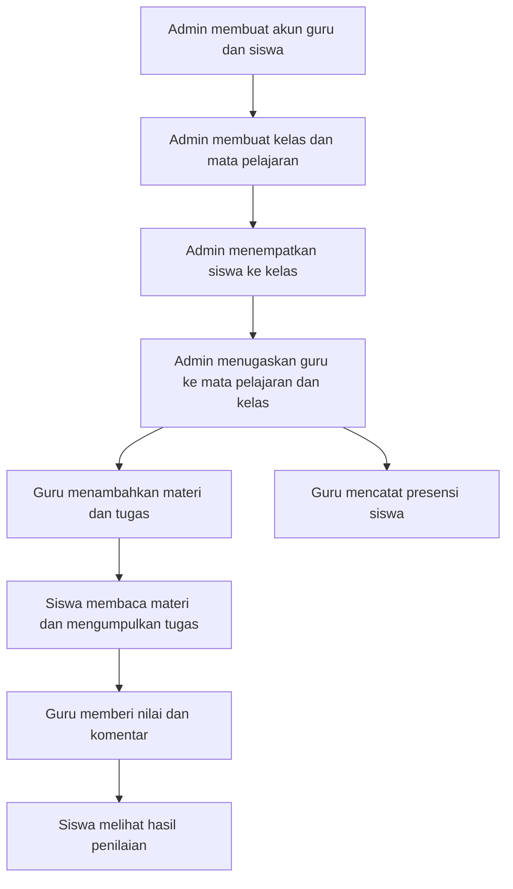

# Alur Uji CRUD EduLMS

Panduan mencoba data baru melalui web, mulai dari admin membuat akun sampai siswa menerima nilai.

Data contoh di bawah **belum otomatis ditambahkan**. Masukkan melalui formulir web. Jika identitas atau kode sudah dipakai, gunakan yang berbeda.

## Gambaran alur

Gunakan tahun ajaran **2026/2027** secara konsisten pada kelas, penempatan siswa, dan penugasan guru. Wali kelas dan penugasan mengajar adalah dua pengaturan berbeda; memilih wali kelas saja belum memberikan penugasan mengajar.

## Data contoh

| Data | Nilai contoh |
|---|---|
| Nama guru | Guru Uji |
| Email guru | `guru.uji@example.com` |
| NIP guru | `199001012026011099` |
| Nama siswa | Siswa Uji |
| Email siswa | `siswa.uji@example.com` |
| NISN siswa | `9090909099` |
| Password kedua akun uji | `UjiCoba!2026` |
| Nama kelas | XI MIPA Uji |
| Tingkat / jurusan | XI / MIPA |
| Tahun ajaran | `2026/2027` |
| Mata pelajaran | Informatika Uji |
| Kode mata pelajaran | `INF-UJI` |
| Materi | Materi Uji 01 |
| Tugas | Tugas Uji 01 |

Siapkan satu PDF untuk materi dan satu PDF untuk jawaban tugas. Gunakan akun admin yang sudah tersedia untuk memulai. Akun guru dan siswa dibuat pada langkah berikutnya.

## 1. Admin menyiapkan data

Login dengan memilih role **Admin** terlebih dahulu.

| Urutan | Menu | Tindakan | Hasil yang perlu dicek |
|---|---|---|---|
| 1 | Pengguna | Buat Guru Uji, pilih role Guru, isi email, NIP, dan password contoh. | Akun muncul pada daftar pengguna sebagai guru aktif. |
| 2 | Pengguna | Buat Siswa Uji, pilih role Siswa, isi email, NISN, dan password contoh. | Akun muncul pada daftar pengguna sebagai siswa aktif. |
| 3 | Kelas | Buat XI MIPA Uji, tingkat XI, jurusan MIPA, tahun 2026/2027. Pilih Guru Uji sebagai wali kelas bila diperlukan. | Kelas muncul pada daftar kelas. |
| 4 | Mata Pelajaran | Buat Informatika Uji dengan kode INF-UJI. Isi kategori dan deskripsi. | Mata pelajaran muncul pada daftar. |
| 5 | Penempatan Siswa | Pilih Siswa Uji dan XI MIPA Uji, tahun 2026/2027, lalu simpan. | Penempatan siswa tercatat dengan status aktif. |
| 6 | Penugasan Guru | Pilih Guru Uji, Informatika Uji, XI MIPA Uji, dan tahun 2026/2027. Isi hari, jam, dan ruang, lalu simpan. | Penugasan guru tercatat aktif. |

- [ ] Akun guru dan siswa berhasil dibuat.
- [ ] Kelas dan mata pelajaran berhasil dibuat.
- [ ] Siswa sudah ditempatkan ke kelas yang benar.
- [ ] Guru sudah ditugaskan ke mata pelajaran dan kelas yang benar.

## 2. Guru membuat pembelajaran

Logout dari admin, pilih role **Guru**, lalu masuk dengan `guru.uji@example.com` dan password contoh.

1. Buka **Kelas & Mata Pelajaran**.
2. Pastikan XI MIPA Uji dan Informatika Uji muncul.
3. Buka pengelolaan materi untuk kelas tersebut, lalu tambah **Materi Uji 01**.
4. Isi deskripsi, unggah PDF materi, lalu simpan.
5. Buat **Tugas Uji 01** untuk penugasan mengajar yang sama.
6. Isi instruksi, tentukan batas pengumpulan yang masih akan datang, dan izinkan format PDF. Simpan tugas.
7. Buka **Presensi Siswa**, pilih kelas dan tanggal, lalu catat kehadiran Siswa Uji dan simpan.

Hasil yang perlu dicek:

- [ ] Kelas guru sesuai dengan penugasan admin.
- [ ] Materi baru muncul dan berkasnya bisa diunduh.
- [ ] Tugas baru tercatat dengan batas pengumpulan yang benar.
- [ ] Siswa Uji muncul dalam daftar presensi.
- [ ] Presensi tetap tersimpan setelah halaman dimuat ulang.

## 3. Siswa mengikuti pembelajaran

Logout dari guru, pilih role **Siswa**, lalu masuk dengan `siswa.uji@example.com` dan password contoh.

1. Buka **Mata Pelajaran** dan pilih Informatika Uji.
2. Buka Materi Uji 01 dan coba unduh PDF.
3. Buka **Tugas**, lalu pilih Tugas Uji 01.
4. Unggah PDF jawaban sesuai batas ukuran yang ditampilkan. Isi catatan bila diperlukan, lalu kirim.

Hasil yang perlu dicek:

- [ ] Informatika Uji terlihat pada akun siswa.
- [ ] Materi dapat dibaca dan PDF dapat diunduh.
- [ ] Tugas memiliki judul dan tenggat yang sesuai.
- [ ] Pengumpulan berhasil dan statusnya berubah menjadi sudah dikumpulkan.

## 4. Guru menilai, siswa memeriksa hasil

1. Logout dari siswa, lalu login kembali sebagai Guru Uji melalui pilihan **Guru**.
2. Buka **Penilaian Tugas** dan cari pengumpulan Siswa Uji pada Tugas Uji 01.
3. Unduh atau periksa berkas jawaban.
4. Masukkan nilai, misalnya **85**, dan komentar **Jawaban sudah baik, lanjutkan latihan.** Lalu simpan.
5. Logout, lalu login kembali sebagai Siswa Uji melalui pilihan **Siswa**.
6. Buka hasil penilaian tugas tersebut.

Hasil yang perlu dicek:

- [ ] Guru dapat mengakses pengumpulan siswa pada kelasnya.
- [ ] Nilai dan komentar berhasil disimpan.
- [ ] Siswa melihat nilai 85 dan komentar yang sama.

## 5. Mencoba ubah, hapus, dan perubahan status

Jalankan bagian ini setelah alur pengumpulan dan penilaian selesai. Gunakan data uji yang dibuat sendiri.

| Modul | Percobaan yang tersedia | Hasil yang perlu dicek |
|---|---|---|
| Pengguna | Admin melakukan reset password akun uji. | Password lama ditolak, password baru diterima. |
| Pengguna | Admin menonaktifkan akun uji, lalu mengaktifkannya kembali. | Akun nonaktif tidak bisa login; setelah aktif kembali bisa login. |
| Kelas | Admin mengganti wali kelas. | Nama wali pada daftar kelas berubah. |
| Mata Pelajaran | Admin mengubah deskripsi. | Deskripsi baru tersimpan setelah halaman dimuat ulang. |
| Penempatan Siswa | Admin mengubah status penempatan. | Status baru tampil pada daftar. |
| Penempatan Siswa | Admin mencabut penempatan uji. | Baris penempatan hilang dari daftar. |
| Penugasan Guru | Admin menonaktifkan lalu mengaktifkan penugasan uji. | Status penugasan berubah sesuai tindakan. |
| Materi | Guru menghapus materi uji. | Materi tidak lagi muncul pada daftar pembelajaran. |
| Pengumuman | Admin membuat pengumuman uji untuk siswa dan menerbitkannya. | Siswa dapat melihat pengumuman. |
| Pengumuman | Admin menyembunyikan pengumuman uji. | Pengumuman tidak lagi terlihat oleh siswa. |
| Pengumuman | Admin menghapus pengumuman uji. | Pengumuman hilang dari daftar admin. |

**Batas fitur saat ini:** belum semua modul menyediakan CRUD lengkap. Pengguna mendukung tambah, lihat, reset password, dan aktif/nonaktif; belum tersedia edit seluruh biodata atau hapus permanen. Kelas mendukung tambah, lihat, dan ubah wali kelas. Mata pelajaran mendukung tambah, lihat, dan ubah deskripsi. Penugasan guru mendukung tambah, lihat, dan aktif/nonaktif.

## 6. Mencoba pembatasan role login

Gunakan password yang benar untuk setiap akun agar yang diuji adalah pembatasan role.

| Akun | Pilihan role saat login | Hasil yang diharapkan |
|---|---|---|
| Siswa Uji | Siswa | Berhasil masuk dashboard siswa. |
| Siswa Uji | Guru atau Admin | Login ditolak. |
| Guru Uji | Guru | Berhasil masuk dashboard guru. |
| Guru Uji | Siswa atau Admin | Login ditolak. |
| Admin yang tersedia | Admin | Berhasil masuk dashboard admin. |
| Admin yang tersedia | Siswa atau Guru | Login ditolak. |

Pemilihan role diperiksa di server. Mengubah pilihan role tidak mengubah role akun yang tersimpan.

## Jika data belum muncul

| Gejala | Yang perlu diperiksa |
|---|---|
| Guru baru belum melihat kelas | Pastikan admin sudah membuat penugasan guru yang aktif, bukan hanya memilih wali kelas. |
| Siswa belum melihat mata pelajaran | Pastikan penempatan siswa aktif dan ada penugasan guru aktif pada kelas tersebut. |
| Data kelas tidak saling terhubung | Cocokkan kelas dan tahun ajaran pada penempatan siswa dan penugasan guru. |
| Tugas tidak bisa dikumpulkan | Periksa tenggat, format berkas, ukuran berkas, dan status pengumpulan yang sudah ada. |
| Akun baru gagal login | Pilih role yang sesuai; periksa email/NISN/NIP, password, dan status aktif akun. |
| Data baru tidak terlihat pada halaman pertama | Periksa filter dan nomor halaman pada pagination. |
