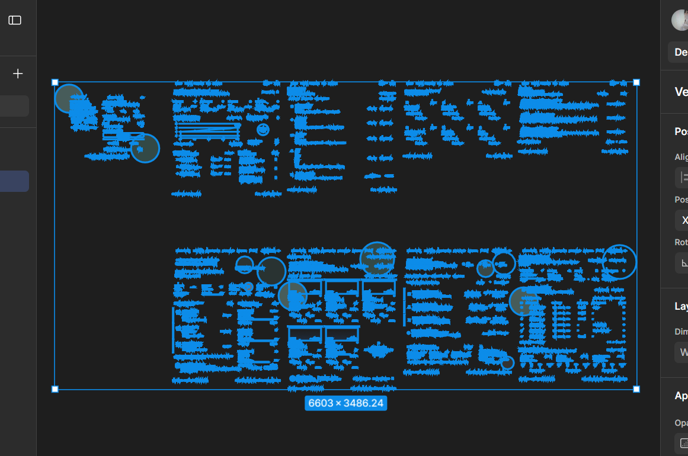
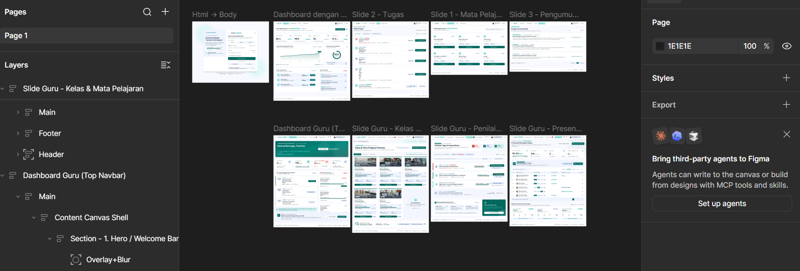

# PERANCANGAN SISTEM

## Learning Management System (EduLMS)

### 1. Halaman Autentikasi (Login Portal Terpadu)
- **Panel Kiri (Informasi Sistem)**
  - Tahun Ajaran Aktif (2024/2025)
  - Judul & Deskripsi Sistem Manajemen Akademik (Kurikulum Merdeka)
  - Statistik Portal (Modul Aktif & Total Siswa Terdaftar)
  - Keamanan Terenkripsi (SSO Kemendikbudristek & Google Edu)
- **Panel Kanan (Formulir Masuk)**
  - Logo EduLMS & Versi Aplikasi (v4.2)
  - **Pilihan Peran Pengguna:** `Siswa` | `Guru` | `Admin`
  - **Input Kredensial:** NISN / Email Akun Belajar & Kata Sandi
  - Opsi: Ingat perangkat ini selama 30 hari & Lupa Sandi?
  - Tombol Utama: **Masuk ke Sistem**
  - Alternatif Masuk: Akun Belajar.id & Token Ujian
  - Bantuan Helpdesk IT Sekolah

### 2. Modul Pengguna: SISWA

#### **A. Header Global Siswa**
- Logo EduLMS, Menu Navigasi (`Dashboard`, `Mata Pelajaran`, `Tugas`, `Pengumuman`)
- Profil Pengguna: Budi Santoso (Siswa) & Tombol Keluar

#### **B. Halaman Dashboard Siswa**
- Banner Sambutan & Tombol `Lanjutkan Belajar`
- **Kartu Statistik Utama:** Rata-rata Nilai, Kehadiran Siswa, Tugas Selesai, Waktu Belajar
- **Visualisasi Grafik:** Grafik Perkembangan Nilai Siswa & Ketuntasan Mata Pelajaran
- **Aktivitas:** Mata Pelajaran Aktif & Tugas Terdekat

#### **C. Halaman Mata Pelajaran Siswa**
- Kolom Pencarian Mata Pelajaran / Pengajar
- Daftar Kartu Mata Pelajaran (Matematika Wajib, Bahasa Indonesia, Fisika, dll) beserta jumlah materi, tugas, dan tombol `Buka Pelajaran`

#### **D. Halaman Tugas Siswa**
- Statistik status tugas (Menunggu & Selesai)
- Filter & Urutkan (Semua, Belum Selesai, Sudah Dikumpulkan, Tenggat Terdekat)
- Daftar Item Tugas dengan tombol `Kumpulkan Tugas` atau `Lihat Nilai`

#### **E. Halaman Pengumuman Siswa**
- Pusat edaran resmi sekolah (Jadwal PTS, Libur Nasional, Ekstrakurikuler) dengan fitur pencarian dan detail pengumuman

---

### 3. Modul Pengguna: GURU

#### **A. Header Global Guru**
- Logo (Portal Guru)
- Menu Navigasi: `Dashboard Guru`, `Kelas & Mata Pelajaran`, `Penilaian Tugas`, `Presensi Siswa`
- Profil Pengguna
#### **B. Halaman Dashboard Guru**
- Banner Sambutan ("Selamat Bertugas, Pak Ahmad Dahlan") dengan tombol cepat `Buat Tugas Baru` & `Tambah Materi`
- **Kartu Statistik Kinerja:** Total Kelas Diajar, Total Siswa Aktif, Tugas Perlu Dinilai, Jadwal Mengajar Hari Ini
- **Jadwal Hari Ini & Besok:** Detail jam mengajar, ruang kelas, status (*Hybrid Learning*, *Tatap Muka*, *Daring*)
- **Perlu Dinilai Segera:** Antrean tugas kelas yang harus dikoreksi beserta persentase penyerahan
- **Pengumuman Akademik:** Batas pengisian nilai tengah semester (PTS) & tombol unduh format rekap / input nilai

#### **C. Halaman Kelas & Mata Pelajaran Diampu**
- Header Manajemen Rombel & Tombol `Tambah Kelas / Modul Baru`
- Tab Filter Kelas (`Semua Kelas`, `XI MIPA 1`, `XI MIPA 2`, dst)
- Daftar Kartu Kelas & Mata Pelajaran (Kurikulum Merdeka, Capaian Silabus Berjalan, jumlah modul, tugas aktif, tombol `Buka Silabus` / `Siswa`, serta opsi `Buka Rombel Baru`)

#### **D. Halaman Penilaian Tugas & Evaluasi Siswa**
- Statistik Evaluasi Aktif (Perlu Dinilai, Sudah Dinilai, Tepat Waktu)
- Filter & Pencarian Judul Tugas / Nama Siswa
- Daftar Pengumpulan Tugas Kelas (Status Tutup/Buka, jumlah berkas belum dikoreksi, tombol `Mulai Koreksi & Input Nilai`, unduh berkas ZIP)
- Panduan Rubrik Penilaian Cepat & Integrasi Sinkronisasi Rapor Instan

#### **E. Halaman Presensi & Kehadiran Siswa**
- Filter Tanggal & Ringkasan Kehadiran Hari Ini (Rata-rata pekan ini, Hadir, Izin/Sakit, Alfa)
- Sesi Aktif Mengajar & Tombol `Tandai Semua Hadir` / `Simpan Presensi`
- Tabel Data Kehadiran Siswa per Kelas (NISN, Status Kehadiran: Hadir/Sakit/Izin/Alfa, Jam Kedatangan, Catatan/Surat Dokter, Aksi Cepat)
- Rekap Presensi & Kehadiran Bulanan per Kelas Binaan & Paralel (Ekspor Excel / PDF)

---

### 4. Footer Website Global
- Hak Cipta © 2024 EduLMS Indonesia
- Tautan: Bantuan, Panduan Belajar, Kebijakan Privasi, Status Layanan

---

https://www.figma.com/design/rBuDsHFdPUlS8LjyrC5ZDM/EduLMS--Copy-?node-id=4001-2&t=r98RG6eo1vZxr0il-1

https://www.figma.com/design/xPze1apaBQ4d6XjGRNPAlp/EduLMS?node-id=0-1&p=f&t=uRVMVtYRQbAmKdzk-0




### 5. Entity-Relationship Diagram (ERD) Sistem

```mermaid
erDiagram
    USER {
        string id_user PK
        string nisn_email
        string password
        string nama
        string peran
        string foto_profil
    }
    SESI_LOGIN {
        string id_sesi PK
        string id_user FK
        datetime waktu_login
        string token_perangkat
    }
    MATA_PELAJARAN {
        string id_mapel PK
        string nama_mapel
        string kelas
        string id_pengajar FK
    }
    MATERI {
        string id_materi PK
        string id_mapel FK
        string judul_materi
        int urutan_modul
    }
    TUGAS {
        string id_tugas PK
        string id_mapel FK
        string judul_tugas
        string deskripsi
        datetime batas_pengumpulan
        string format_file
    }
    PENGUMPULAN_TUGAS {
        string id_pengumpulan PK
        string id_tugas FK
        string id_siswa FK
        datetime tanggal_kumpul
        string file_tugas
        string status
        float nilai
    }
    PRESENSI {
        string id_presensi PK
        string id_mapel FK
        string id_siswa FK
        date tanggal_sesi
        string status_kehadiran
        string jam_kedatangan
        string catatan_keterangan
    }
    PENGUMUMAN {
        string id_pengumuman PK
        string id_pembuat FK
        string judul_pengumuman
        string kategori
        string isi_pengumuman
        datetime tanggal_terbit
    }
    STATISTIK_SISWA {
        string id_statistik PK
        string id_siswa FK
        float rata_rata_nilai
        float persentase_kehadiran
        float waktu_belajar_jam
    }

    USER ||--o{ SESI_LOGIN : "autentikasi"
    USER ||--o{ MATA_PELAJARAN : "mengajar"
    MATA_PELAJARAN ||--|{ MATERI : "memiliki"
    MATA_PELAJARAN ||--|{ TUGAS : "memberikan"
    USER ||--o{ PENGUMPULAN_TUGAS : "mengumpulkan"
    TUGAS ||--o{ PENGUMPULAN_TUGAS : "untuk"
    USER ||--o{ PRESENSI : "presensi"
    MATA_PELAJARAN ||--o{ PRESENSI : "pencatatan"
    USER ||--o{ PENGUMUMAN : "menerbitkan"
    USER ||--|{ STATISTIK_SISWA : "memiliki"